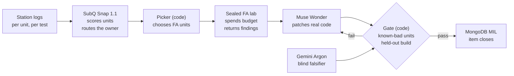
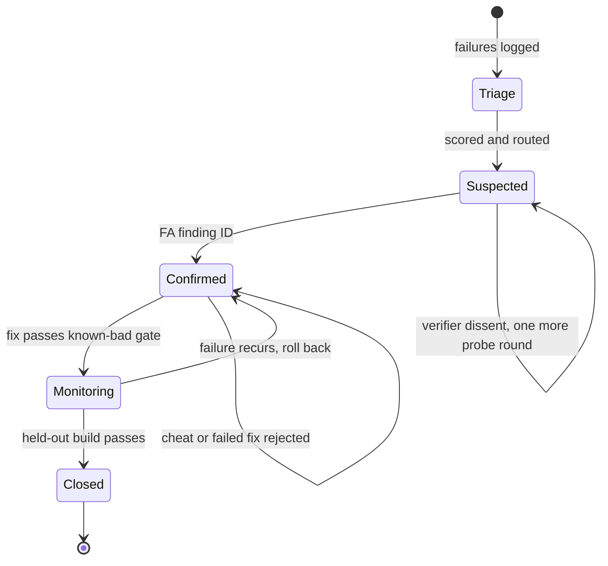
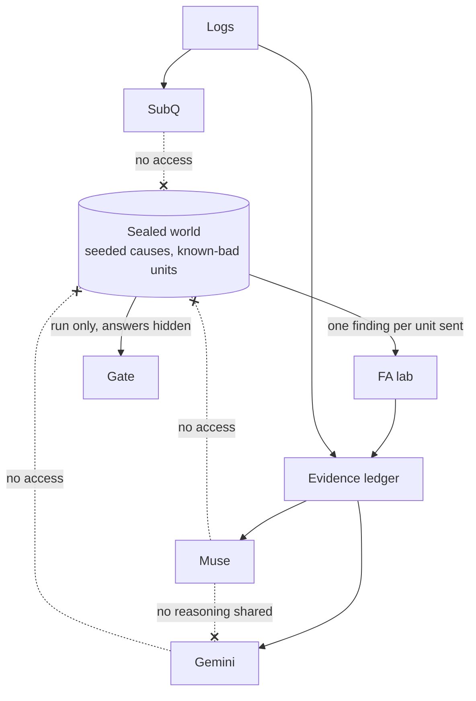

# Closeout by N+1 Labs

**Failure in. Proven fix out.**

Closeout solves complex factory failures, physical or firmware, and closes each one only when a held-out build proves the fix.

> The MIL says Material. The parts are fine.

**Live site:** [closeout-web.vercel.app](https://closeout-web.vercel.app) (fixture data, labeled on screen)

Built at the AIE Code Summit Hackathon on 2026-11-07. Everything here was written during the event. The product, the line and every failure are fictional, and all data is synthetic and seeded. This proves the loop, not the physics.

## The problem

Hardware launches slip because root cause takes physical units, scarce FA time and several teams who each blame the other. Major Issues List (MIL) items then close on a yield bump, and the defect comes back.

| Failure type | Example | Why it stays open | How it closes |
| --- | --- | --- | --- |
| **Physical** | A dome is bonded out of position | Only FA can see it | FA confirms, a process change ships, a held-out build holds |
| **Firmware** | A calibration write gets dropped | It only appears on some units | An agent patches real code, a held-out build holds |
| **Both** | A slow part meets a cold start | It looks like Material, and the fix is in firmware | FA re-routes it, then the same gate decides |

**User:** an early hardware startup with no dedicated FA team, right after a yield step-down.

## The demo in one failure

**Cold Dome.** A fictional beacon fails dome uniformity at the optical station. The MIL blames LED material. The real cause: a cold second-source LED driver starts slowly, so firmware's calibration write gets dropped.

1. Logs stream in and the MIL item opens as **Material**.
2. SubQ scores every failed unit in one call.
3. A judge picks 5 FA units, and SubQ's scores pick 5. FA findings re-route the item to **Firmware**.
4. Gemini tries to kill the root cause on sealed evidence.
5. A cheat fix widens the test limit. Yield rises, known-bad units pass, and Closeout **blocks it**.
6. Muse patches the firmware. Known-bad units still fail, and cold units pass.
7. A held-out build passes, and the item closes with its audit trail.

## How it works

SubQ decides. Muse fixes. Gemini doubts. Code keeps score. MongoDB remembers.



| Part | Job | Never does |
| --- | --- | --- |
| **SubQ Snap 1.1** | Up to 128 typed decisions per call over up to 384K tokens: hypothesis scores, owner category | Confirm a root cause |
| **Code** | Pick units, compute rates, run gates, decide pass or fail | Guess |
| **Muse (`muse-wonder-1.0`)** | Patch firmware and test code | Grade its own patch |
| **Gemini (`gemini-4-argon`)** | Try to falsify the claim from evidence only | See Muse's reasoning |
| **MongoDB** | Hold the MIL, evidence and revisions. Reject invalid closes | Accept `confirmed` without an FA finding |

## How an item closes

Closing is a state machine, so no agent can talk an item shut.



## Who can see what

Independence is the point, so each actor gets only part of the truth.



## Rules

- Rates, scores and gate results come from code, never a model.
- `confirmed` requires an FA finding ID.
- A fix that lets a known-bad unit pass is rejected, whatever it does to yield.
- An item cannot close before a held-out build passes.
- Verifier dissent keeps the cause `suspected` and adds one probe round.
- Every screen and record says `live`, `fixture`, `replay` or `simulated`.

## Measured so far

One SubQ Snap 1.1 call on 128 seeded failed units with overlapping causes, using a first greedy picker:

| Check | Result |
| --- | --- |
| Call time | 2.54 s |
| Top choice matched the seeded cause | 41.4% |
| High-confidence answers (0.8 to 1.0, 31 units) | Said 93%, right 71% |
| Failed units explained by 5 FA picks: SubQ picker | 73.4% |
| Random, 2,000 trials | 78.6% |
| Lowest uniformity first | 79.7% |

This first picker lost to both baselines, on one small scenario. FA routing is unproven. The headline metric will be FA units to root cause across at least 20 sealed scenarios, reported whichever way it lands. SubQ outputs stay "scores" until a calibration check justifies "probabilities."

## Build plan

| Task | Scope | Owner | Status |
| --- | --- | --- | --- |
| 0 | Access gates for each sponsor | Muse | In progress |
| 1 | Contracts, failure library, log generator | Muse, Codex | Blocked on contracts |
| 2 | Firmware and fake hardware layer | Muse | Not started |
| 3 | FA picker, baselines, calibration, metric | Muse | Not started |
| 4 | Patch loop, Gemini, known-bad gate | Muse | Not started |
| 5 | MongoDB MIL ledger and gates | Muse | Not started |
| 6 | Judge-facing site | Claude Code | Live on fixture data |
| 7 | Rehearsal, one-minute video | Ben | Not started |

Freeze at 4:15 PM PT. Video by 4:45 PM PT.

**Fallback ladder:** live SubQ → cached scores. Live Gemini → pre-run verdict. Live Muse patch → trace replay. Anything on a fallback says `replay` on screen.

## Repo

```text
web/     Judge-facing Next.js site on Vercel. FA answers stay on the server.
engine/  Scaffold for the engine. Replace with the spec's folders as they land.
docs/    run-contract.md, the JSON the engine writes and the site reads.
```

## Where it goes

Closeout comes from N+1 Labs. This repo holds no N+1 product data or code. No real product, employer data or customer data is used.
