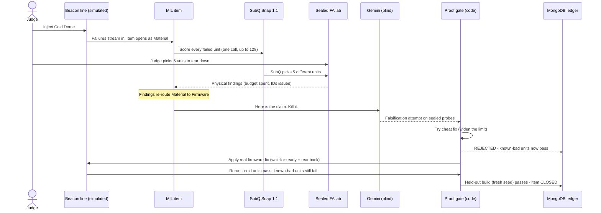
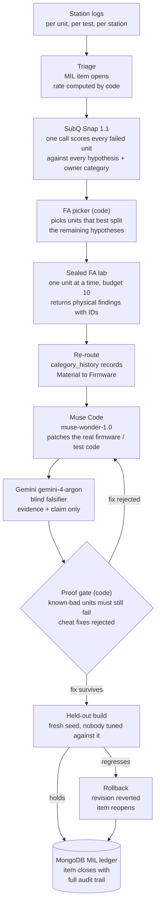
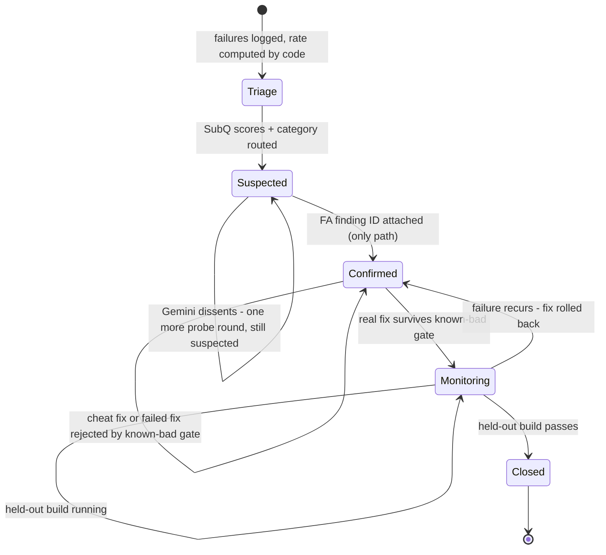
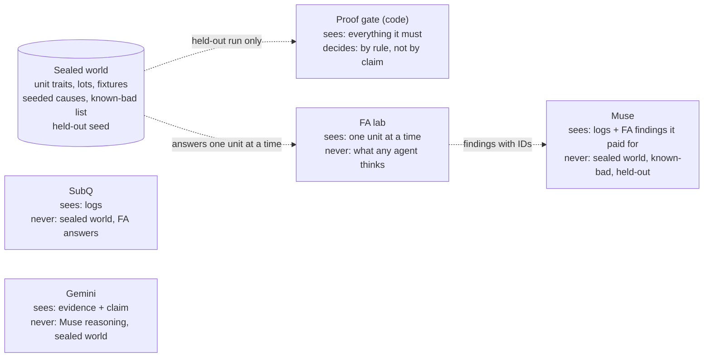
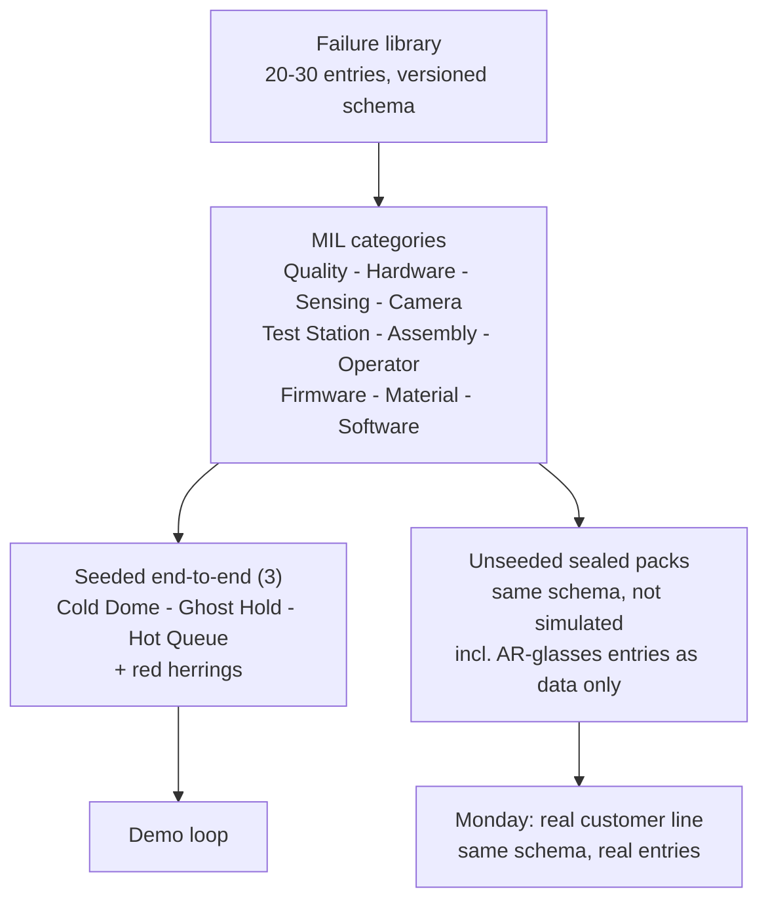
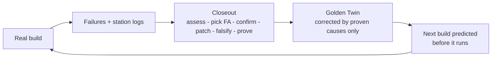

# Closeout by N+1 Labs

**Failure in. Proven fix out.**

Closeout is a Failure Analysis (FA) engine for hardware factories. It takes the failures a line already produces, spends scarce FA teardown on the units that teach the most, confirms a root cause with physical evidence, patches the real code or process, and closes the issue **only when a fresh held-out build proves the fix held**.

> The MIL says Material. The parts are fine. It was firmware, at cold start, on a second-source part — and no single team owned it.

**Live site:** [closeout-web.vercel.app](https://closeout-web.vercel.app) — currently on `fixture` data, labeled on every screen.
**Repo:** [benikigai/closeout](https://github.com/benikigai/closeout) (public, built 2026-11-07 at the AIE Code Summit Hackathon)
**Built with:** Muse Code (`muse-wonder-1.0`) · SubQ Snap 1.1 · Gemini (`gemini-4-argon`) · MongoDB

Everything in this repo was written during the event. The product, the line, and every failure are fictional. All data is `synthetic` and seeded. This proves the loop, not the physics. No N+1 Labs product data, customer data, employer data, or Golden Twin code is in this repo.

---

## 1. Why this exists

### The problem: factory failures close on opinion, not proof

Every hardware program runs a Major Issues List (MIL): one row per open failure, with a station, a failure rate, an owner, and a suspected cause. The workflow around it has not changed in decades:

1. Yield steps down. A MIL item opens.
2. Three teams form three theories — assembly blames material, material blames the test station, the station blames firmware.
3. A handful of failed units get sent to Failure Analysis. FA is slow, destructive, and scarce, so *which* units you send decides what you learn.
4. Weeks later, a root cause is "confirmed" — often on a yield bump, a retest pass, or a senior engineer's conviction.
5. A fix ships. Yield improves. The item closes.
6. The defect comes back two builds later, because the yield bump was a lot change, a fixture swap, or the weather.

The expensive failures are the ones that cross team boundaries:

| Failure type | Factory example | Why it stays open | How Closeout closes it |
| --- | --- | --- | --- |
| Physical | A dome bonded out of position | Only destructive FA can see it | FA confirms, process change ships, held-out build holds |
| Firmware | A calibration write silently dropped | Appears only on some units, some temperatures | Real code is patched and rerun, held-out build holds |
| Both (the killer) | A slow second-source part meets a cold start | Logged as Material, fixed in Firmware, owned by no one | FA evidence re-routes the owner, then the same proof gate decides |

Three structural gaps make this worse at an early hardware company:

- **No dedicated FA team.** The founder *is* FA. Every wrong teardown pick burns the scarcest hours in the building.
- **FA picks are gut feel.** Engineers send the worst-looking units. Worst-first *feels* rigorous and systematically teaches you the least, because extreme units are usually extreme for several overlapping reasons.
- **Nothing forces proof.** A MIL item is a spreadsheet row. Nothing stops it closing on a claim. Nothing versions the fix, links it to the evidence, or rolls it back when the next build regresses.

### The insight

Failure analysis is a **decision problem under a teardown budget**, not a search problem.

You can never tear down every failed unit. So the real questions are, in order:

1. *Which few units, if we open them, split the remaining hypotheses the most?* (information, not severity)
2. *What does the physical evidence actually confirm — versus what a model merely suspects?* (evidence, not confidence)
3. *Did the next build prove the fix, on units nobody tuned against?* (proof, not yield)

Closeout is those three questions, built as software with hard gates between them. A model may propose at every step. **Only physical evidence confirms, and only a held-out build closes.**

### Who it is for

- **Primary:** an early hardware startup right after a yield step-down — founder-led, no dedicated FA team, MIL in a spreadsheet, FA by gut feel.
- **Next:** any team running builds where firmware, parts, and process change at the same time — consumer hardware, robotics, wearables, EV subsystems, test equipment.
- **Not for:** high-volume lines with mature SPC/FA departments and years of labeled failure history. They have the data this system synthesizes. Closeout is for teams who will never have that history in time.

---

## 2. The demo in one failure: Cold Dome

One fictional product carries the whole demo: an **andon-style station beacon** — a frosted light dome, a touch cap, a 2-mic array, a speaker, an IMU, BLE/Wi-Fi — built on an invented 8-station line. Every station in a factory needs one. We build beacons for stations, on a station, and Closeout closes their failures.

**The seeded fault (hero):** at the optical station, some beacons fail dome uniformity. One side of the dome glows dim. The MIL opens it as **Material** — a bad LED lot.

**The real cause:** a second-source LED driver starts slowly when cold. Firmware writes its calibration value at a fixed 50 ms after boot, whether or not the driver is ready. On cold units the write is dropped. The LEDs are fine. The parts are fine. It is a firmware timing bug that only exists for one vendor's part, below a temperature, on some units.

Two more faults are seeded as data packs with defined negative controls, plus red herrings:

| Fault | First blame (wrong) | Real cause | Category re-route |
| --- | --- | --- | --- |
| **Cold Dome** (hero) | LED material lot | Cold second-source driver drops firmware calibration write | Material → Firmware |
| **Ghost Hold** | Touch controller defect | Touch baseline captured after the grounded nest closes | Sensing → Test Station |
| **Hot Queue** | Mic array defect | Mic temperature-compensation table exhausted on warm units | Sensing → Firmware |
| Red herrings | LED lot step-up, dome bonding haze, fixture wear | Correlated, not causal | — (must *not* be confirmed) |

**The 3-minute story a judge watches:**



Five words for the room: **"Dim dome. Firmware did it."**

---

## 3. How it works

**SubQ decides. Muse builds and patches. Gemini doubts. Code keeps score. MongoDB remembers. Only FA confirms. Only a held-out build closes.**



No step trusts the previous step's word:

- SubQ *scores*. It never confirms.
- Muse *patches*. It never grades its own patch.
- Gemini *attacks*. It never sees Muse's reasoning.
- Code *computes and gates*. It never guesses.
- FA *finds*. One unit at a time, for budget, with finding IDs.
- The held-out build *decides*. A fresh seed is the only closer.

---

## 4. How an item closes: the state machine

Closing is enforced by a state machine and a database schema, not by an agent's confidence. No model can talk an item shut.



The gates, in code and in the MongoDB `$jsonSchema`:

| Gate | Rule | What it blocks |
| --- | --- | --- |
| Confirmation gate | `root_cause.status = confirmed` requires at least one FA finding ID | A model "confirming" a cause from log vibes |
| Cheat gate | A fix that lets any known-bad unit pass is rejected, whatever it does to yield | Limit-widening, loosened tests, silent retest filtering |
| Category gate | Every re-route is appended to `category_history[]` with a reason | Quietly rewriting who was wrong |
| Closeout gate | Status cannot reach `closed` before held-out monitoring passes | Closing on the build that shipped the fix |
| Computation gate | Rates, scores, and gate results are computed by code, never written by a model | Invented numbers in the ledger |
| Label gate | Every record and screen carries `live` / `fixture` / `replay` / `simulated` | A replay presented as a live result |

---

## 5. Who can see what (blindness is the product)

Each actor gets only the slice of truth its job needs. The splits are enforced by the architecture — separate folders, a sealed evidence file the browser never receives whole, and an external model from a different vendor — not by prompting a model to "pretend you didn't see that."



| Actor | Job | Never does |
| --- | --- | --- |
| **SubQ Snap 1.1** | Up to 128 typed decisions per call over up to 384K tokens of logs: hypothesis scores per failed unit, owner-category call | Confirm a root cause; see the sealed answer key |
| **FA picker (code)** | Choose the teardown units that best split remaining hypotheses; run random + worst-first baselines against the same picks | Defer to severity ("worst-looking first") without measuring it |
| **Muse Code (`muse-wonder-1.0`)** | Build the line, the firmware, and the fix; patch real code; rerun it | Grade its own patch; see known-bad units or the held-out seed |
| **Gemini (`gemini-4-argon`)** | Blind falsification: given only evidence + the claimed cause, try to produce a unit that breaks it | See Muse's reasoning, diff intent, or the sealed world |
| **MongoDB** | Hold the MIL, evidence, revisions, and audit trail; reject invalid closes at the schema layer | Accept `confirmed` without an FA finding ID |
| **Judge (you)** | Inject the fault, pick your own 5 FA units, watch the race | Get a number nobody can reproduce |

---

## 6. The tech stack, used in non-obvious ways

Closeout is not "an LLM app with five logos." Each sponsor surface does the one job it is structurally best at, and is barred from the jobs it is worst at:

| Surface | Normal use | How Closeout uses it | Why only this fits |
| --- | --- | --- | --- |
| **SubQ Snap 1.1** | Fast typed classification | One call turns 384K tokens of station logs into up to 128 scored decisions — a probability-shaped score for *every hypothesis × every failed unit*, plus the owner-category call. Code then picks teardown units by expected hypothesis-split. | A generative model answers one question slowly and argues. FA triage is 128 small judgments at once, for ~$0.015 a call — cheap enough to re-run the entire assessment on every new log batch. |
| **Meta Muse Code** (`muse-wonder-1.0`) | Chat / code completion | The builder *and* the fixer. It writes the station firmware, the fake hardware layer, and — when FA confirms Cold Dome — the corrective patch itself (wait-for-ready + readback verify), then reruns the real compiled code per virtual unit. Yield moves because compiled code changed, never because a model claims it did. | The fix has to be a real diff to real code that a compiler and a held-out build can judge. A model that only writes prose about a fix cannot be gated. |
| **Google Gemini** (`gemini-4-argon`) | Multimodal generation | A blind, cross-vendor falsifier. It receives evidence and the claimed root cause — never Muse's reasoning — and is paid to break the claim with a counterexample unit. Dissent is a defined state (cause stays `suspected`, one more probe round), not an error. | A verifier from the same vendor and context shares the builder's blind spots. Blindness + a different vendor is what makes "verified" mean anything. |
| **MongoDB** | Document store | The MIL itself, as a strict `$jsonSchema` ledger: `confirmed` is *unrepresentable* without FA finding IDs, rates are code-computed, every revision is promotable and rollback-able, and the Material → Firmware re-route is preserved as history. | The ledger is the enforcement layer. A spreadsheet lets anyone type "closed." A schema that rejects an unproven close is the product's spine. |
| **Next.js on Vercel** | Web app | A judge surface, not a dashboard: fault injection, the SubQ question wall flipping in one call, judge-picks-5 vs SubQ-picks-5, the cheat-fix rejection, and the closeout moment. FA answers live in a server-only sealed file and are never sent whole to the browser. | The loop is the product; a results dashboard would hide it. The demo *is* the assessment happening. |

Deliberately deferred: **Fetch.ai / ASI:One** is an adapter-last verdict-card surface (a stranger hiring the FA verdict inside ASI:One chat). It is only claimed if that flow completes end-to-end against live ledger state, and it is the first thing cut if the core loop slips. It is not in the critical path and this README does not claim it.

---

## 7. What exists today, and what does not

Honesty labels, per surface. `RUN` = observed by executing it today. `simulated` = synthetic seeded data, labeled on screen.

| Surface | State | Evidence |
| --- | --- | --- |
| SubQ Snap 1.1 decisions | `live` (RUN) | Models + decision calls return 200. One seeded assessment: 128 failed units scored in 2.54 s |
| Meta models (`muse-wonder-1.0`) | `live` (RUN) | Model list + builder calls verified today |
| Gemini (`gemini-4-argon`) | `live` (RUN) | Blind-verifier call completes in ~6 s |
| Station firmware + fake HAL | `live` (RUN) | Small C firmware, deterministic per-unit runs: warm passes, cold fails, known-bad always fails, rerun identical (4/4 tests) |
| Judge site | `live` on `fixture` data | [closeout-web.vercel.app](https://closeout-web.vercel.app) — fixture state labeled on screen |
| Contracts (log / MIL / FA / UI schemas) | `live` | JSON Schema contracts for log records, MIL items, the FA lab interface (`POST /fa/investigate`, budget 10, over-budget rejected), and the picker signature |
| MongoDB ledger | Schema defined, local-first | Atlas connection pending re-auth; the demo never blocks on it. Atlas is claimed only when verified live |
| Scaffold line + sealed FA lab (full) | In build | Deterministic generator + FA lab API per the contracts above |
| Fetch / ASI:One adapter | Deferred (cut-first) | Go/no-go at core acceptance; not claimed until end-to-end |

### Measured so far — including the loss

One SubQ call on 128 seeded failed units whose causes overlap on purpose, scored with a first greedy picker:

| Check | Result |
| --- | --- |
| Call time | 2.54 s for 128 units |
| Top choice matched the seeded cause | 41.4% |
| High-confidence answers (score 0.8–1.0, 31 units) | Said ~93%, right 71% — overconfident; we say "scores," not "probabilities," until calibration earns the word |
| Failed units explained by 5 FA picks, SubQ picker | 73.4% |
| Random picks (2,000 trials) | 78.6% |
| Lowest-uniformity-first | 79.7% |

**The first picker lost to both baselines.** On one small scenario, FA routing is unproven — and that is exactly the kind of result this system exists to surface instead of hide. The headline metric going forward is pre-registered: *FA units to root cause, across at least 20 sealed scenarios per strategy (SubQ picks vs random vs worst-first), reported whichever way it lands.* If SubQ's picks do not beat the baselines, the pitch says so and the picker's split logic is what gets fixed.

---

## 8. The factory failure library (breadth ships as data)

"All failures a factory sees" is a data problem, not a simulation problem. Closeout ships it as a versioned library, not as fake physics for everything:



Each entry carries: failure name, station, log symptom, hidden physical cause, the red herring everyone blames first, the cheat fix that must be rejected, the real fix, and the one FA test that discriminates it. Every entry is labeled `logic credible` (simulation can expose it) or `rate not credible` (simulation must never quote a failure rate for it). If a judge asks "does this work for AR glasses?" — the answer is the pack, not a promise.

## 9. Repo map (for hackers)

```text
web/       Judge-facing Next.js site on Vercel. FA answers stay server-side.
           Reads web/data/run.json. web/data/sealed.json is gitignored.
engine/    Scaffold line, toy twin, station code, sealed FA lab, agent loop.
docs/      run-contract.md — the JSON the engine writes and the site reads.
firmware/  (landing) Small C firmware + fake HAL. Muse patches these files.
```

Run contract in one line: the engine writes one `run.json` (`live` / `replay` / `fixture`, shown on every screen); the sealed FA answers live in a server-only file and are never sent whole to the browser. Regenerate fixture data from `web/` with `SUBQ_API_KEY=... python3 scripts/make_fixture.py`. Keys stay in the local 1Password environment mount; only key names ever appear in this repo.

## 10. Why N+1 Labs, and where this goes

N+1 Labs builds the **Golden Twin**: a twin of the line that builds your product, corrected by every real build. A twin is only as good as its correction loop — and today that loop is a spreadsheet, gut-feel FA, and fixes nobody proved.

**Closeout is that correction loop.**



What Monday looks like, unchanged engine, real data swapped in:

1. A customer's line definition replaces the fictional beacon line (same 8-station schema shape).
2. Real station logs replace the seeded generator (same log-record contract).
3. The failure library grows from the customer's own MIL history — every closed item makes the next assessment sharper.
4. The same gates hold: no `confirmed` without FA evidence, no close without a monitored build.

This is also N+1's validation muscle, productized: the sealed held-out build is the same discipline as a blind backtest — predict first, let units you never tuned against decide, report whichever way it lands.

The hackathon artifact stays clean on purpose: fictional product, synthetic data, everything built today, no Golden Twin code, no calibration IP. What transfers is the loop, the contracts, the ledger schema, and the gates.

---

## 11. Read this before you believe it

- **Live vs fixture:** SubQ, Meta, and Gemini calls are verified live today. The judge site currently renders `fixture` data and says so on screen. Switching it to the real `run.json` is the freeze step, not a rewrite.
- **Scores vs probabilities:** SubQ outputs are called *scores* in the UI and this README. The one calibration check so far showed overconfidence (said ~93%, right 71%), so probability language has to be earned by the 20-scenario calibration run.
- **Picker status:** the first FA picker lost to random and worst-first baselines on the first scenario. Unproven, pre-registered metric, result will be published either way.
- **Simulation boundary:** this demos the *loop* (logic, routing, gating, proof), not physics. Failure magnitudes from the synthetic world are never quoted as real-world rates.
- **Deferred, not hidden:** MongoDB Atlas goes live only after re-auth verification; Fetch/ASI:One is cut-first and unclaimed until end-to-end. Both are labeled where they appear.

---

*Closeout by N+1 Labs — built at the AIE Code Summit Hackathon, 2026-11-07. Failure in. Proven fix out.*


